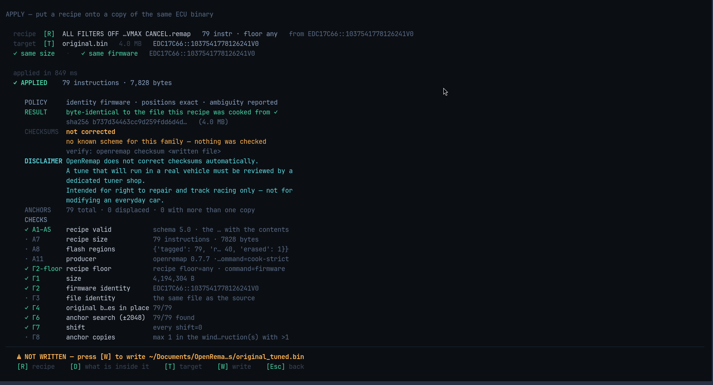
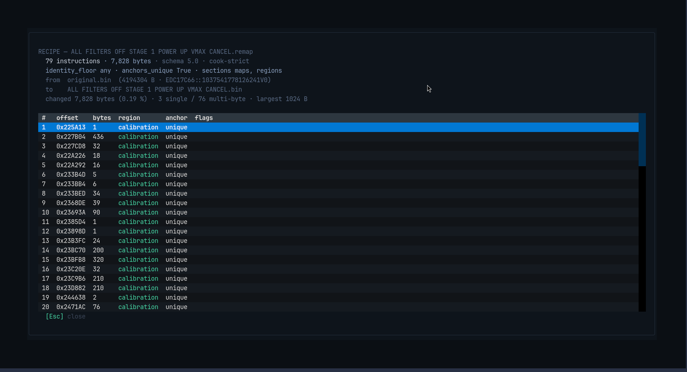

# APPLY

You have a recipe (the list of changes) and a file you want to change. APPLY does
it, and proves it worked.



## Reading the result

| Line | Meaning |
|---|---|
| `✓ APPLIED` | how many changes went in, how many bytes were written |
| `POLICY` | what this run insisted on before writing |
| `RESULT` | the patched file is **byte-identical** to the file the recipe was made from |
| `CHECKSUMS` | whether the result's check numbers are valid — usually `not corrected` |
| `DISCLAIMER` | the standing warning, always shown |
| `CHECKS` | every check it ran, with a short rule id, pass or fail |
| `⚠ NOT WRITTEN` | the result is in memory only, and where it would be saved |

The `CHECKSUMS` block is the one to read before flashing anything:

```
CHECKSUMS   not corrected
            no known scheme for this family — nothing was checked
            verify with  openremap checksum <written file>
```

OpenRemap never rewrites a checksum. If it says `skip`, nobody checked — you still
need a tool to fix the checksum, and a tuner to review the file.

## What is inside the recipe

Press `D` to see the recipe itself, instruction by instruction:



Every row is one change: where it is (`offset`), how many bytes, which part of the
file it is in (`region`), whether its position could be pinned down uniquely
(`anchor`), and any flags. This is the same file you could open in a text editor.

## Keys

| Key | What it does |
|---|---|
| `R` | choose the recipe |
| `T` | choose the target file |
| `Enter` | apply |
| `D` | show the recipe's list of changes |
| `W` | write the patched file into `tunes/` |
| `Esc` | back to HOME |

## If it refuses

A refusal is a normal answer, not a crash. It names the rule that stopped it, and
then — sometimes — offers a looser way:

| If it refused because… | It offers | What you give up |
|---|---|---|
| the files are not the same software | `U` | the safety of that check |
| a change sits at a slightly different place | `S` | exact positioning |
| a change is ambiguous | `A` | both of the above |

If no looser option can help — wrong size, wrong file, already patched — it says so
plainly and offers nothing. **There is no "force" flag anywhere in this tool:** you
pick a command, and the command *is* the policy.

## Writing the result

```
⚠ NOT WRITTEN — press [W] to write   ~/Documents/OpenRemap/tunes/original_tuned.bin
```

Your input file is never overwritten. The new file is a separate copy, written only
when you press `W`.
