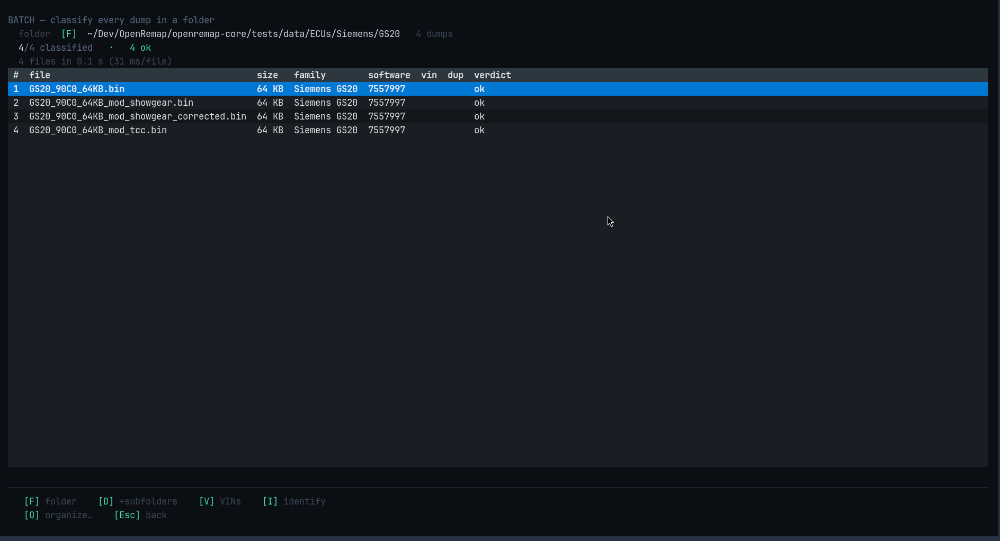
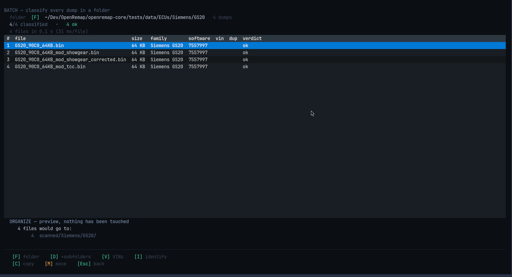

# BATCH

A folder full of dumps is not a list of equal things: some are identified, some are
recognised but have no software version, some are claimed by two families, some are
not ECUs at all, and some are the same file twice. BATCH says which is which.



## Reading the table

| Column | Meaning |
|---|---|
| `file` | the file name |
| `size` | how big it is |
| `family` / `software` | what it was recognised as |
| `vin` | vehicle ID — **off by default**, see below |
| `dup` | marked when two files are identical |
| `verdict` | `ok`, `sw_missing`, `contested`, `unknown`, or unreadable |

The line above the table is honest about speed: `4 files in 0.1 s (31 ms/file)`,
measured, not estimated.

## Tidying up afterwards (a second step)

Classifying **never moves anything**. Press `O` and the app shows you where every
file would go, without touching a single one:



```
ORGANIZE — preview, nothing has been touched
  4 files would go to:
     4 scanned/Siemens/GS20/
```

Only then `C` copies, or `M` moves. **Copying is the default**, because a copy
cannot lose a dump.

## The VIN column is opt-in

Press `V` to show it. VINs are only printed as a real number when they pass their
own check digit; otherwise you see a candidate with its confidence, like `~0.45`.
That is why it is not on by default — a guess should not look like a registration.

## Keys

| Key | What it does |
|---|---|
| `F` | choose the folder |
| `Enter` | start classifying |
| `D` | include sub-folders (or say that there are none) |
| `V` | show the VIN column |
| `I` | open the selected file in [IDENTIFY](identify.md) |
| `O` | preview the tidy-up |
| `C` / `M` | copy / move, after the preview |
| `Esc` | stop and keep what is done, or go back |

`Esc` while it is working stops the scan and keeps everything already classified.
