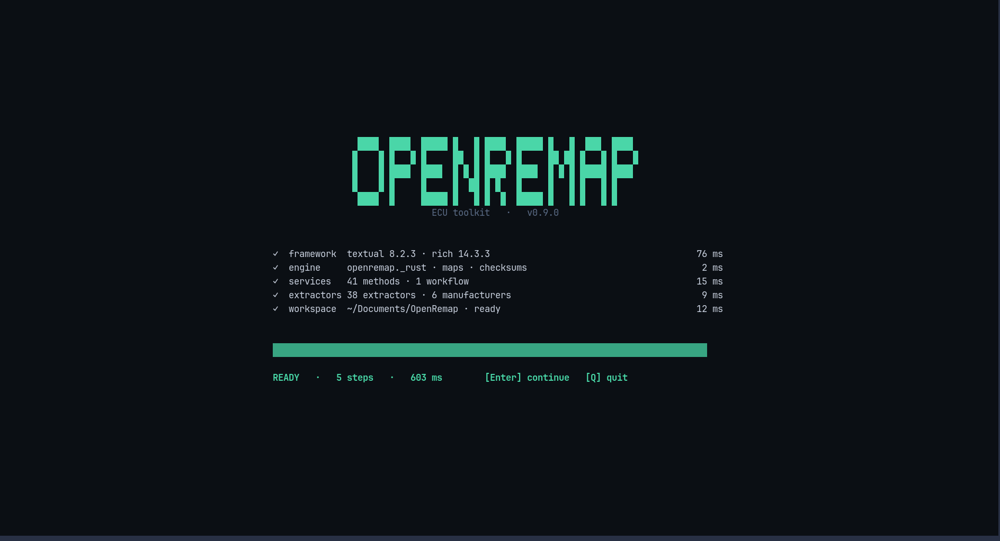

# BOOT

This is what the app does in the first second after you type `openremap`. It is
not an animation: each line is a real check, and the number on the right is how
long that check took.

## What each line means

| Line | In plain words |
|---|---|
| `framework` | the screen library loaded — `textual 8.2.3` |
| `engine` | the fast native part of the program loaded — `openremap._rust` |
| `services` | the toolbox behind the screens loaded — `41 methods` |
| `extractors` | the code that recognises ECU families loaded — `38 extractors · 6 manufacturers` |
| `workspace` | the folder where results are saved exists — `~/Documents/OpenRemap` |

At the bottom: `READY · 5 steps · 603 ms`, which is the total, and the two keys you
can press.

## Keys

| Key | What it does |
|---|---|
| `Enter` | continue to [HOME](home.md) |
| `Q` | quit |
| `R` | try the checks again — appears only if one of them failed |

## If a line is red

The line turns red and a small panel opens with the command that fixes it. The
panel names the failing step, so you know what to search for.

| Failing line | Usually means |
|---|---|
| `framework` | the install is incomplete — reinstall with `uv tool install openremap` |
| `engine` | the native part is missing — same fix, or rebuild it from a clone |
| `services` / `extractors` | the install is damaged — reinstall |
| `workspace` | your home folder cannot be written to — the app still works, it just cannot save |

> [!NOTE]
> This screen is also the fastest way to answer "is my install OK?". If these five
> lines are green, everything else in the app will work.
