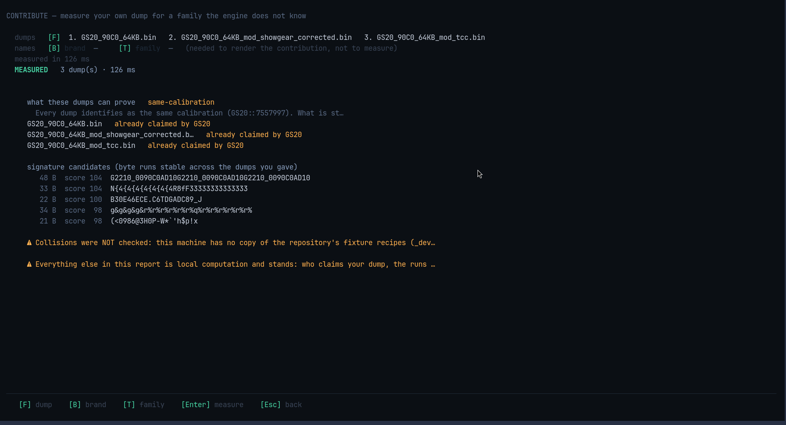

# CONTRIBUTE

If your ECU is not recognised, you can help add it. The wizard measures **your own
files** and writes what a developer needs, without you sharing them.

## The promise, on screen

> Your dumps never leave this machine. What a contribution commits is a synthetic
> fixture carrying only the marker, an extractor skeleton, a test and a report —
> never your binary.

## What you see after pressing `Enter`

| Line | Meaning |
|---|---|
| `MEASURED 3 dump(s) · 126 ms` | how many files it read, and how fast |
| `what these dumps can prove` | whether your files can even support a contribution |
| `already claimed by GS20` | someone else's code already recognises these files |
| `signature candidates` | byte patterns that are identical in all your files, with a score |
| `⚠ Collisions were NOT checked` | the honesty line — it could not test against other families |

That second line matters. Files of the **same** calibration can never prove a
pattern is family-wide, so the tool tells you which case you are in before showing
any candidates.

## Two steps

| Step | Key | What happens |
|---|---|---|
| **measure** | `Enter` | pure calculation on your files. Nothing is written, nothing is checked against other families |
| **prepare** | `P` | needs a brand and a family; runs the collision check, renders the extractor, test, report and fixture, and runs the review bar over them |

Until `P` has run, "no collisions" has not been tested — and the screen says exactly
that instead of implying the pattern is safe.

## Keys

| Key | What it does |
|---|---|
| `F` | add files (two or more, ideally different calibrations) |
| `B` | set the brand name |
| `T` | set the family name |
| `Enter` | measure |
| `P` | prepare the contribution |
| `W` | write the files out |
| `Esc` | back to HOME |

The same thing from the command line is
[`openremap contribute`](/cli/contribute).
