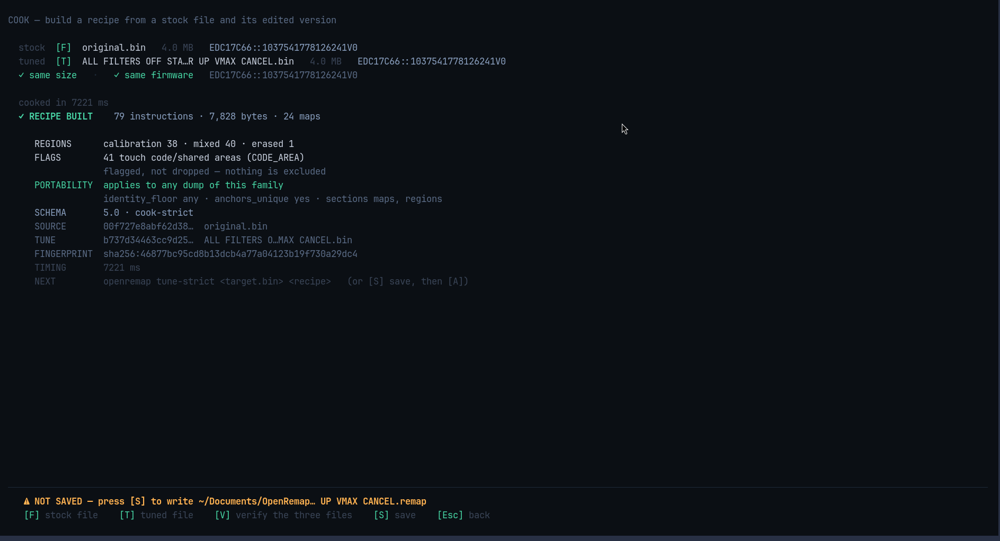
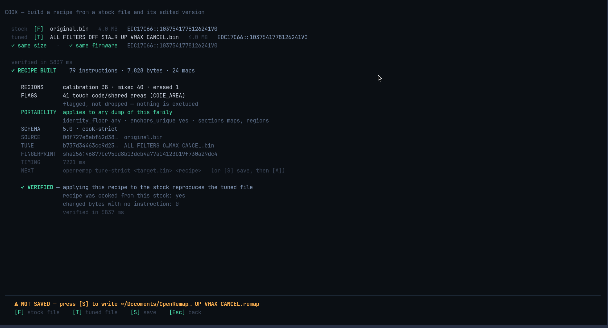

# COOK

You have two files: the one the car came with (**stock**) and the one a tuner
changed (**tuned**). COOK compares them and writes down every difference as a
**recipe** — a small file you can read, share, and apply to another car later.



## What you see

**Top:** the two files, their sizes, and the match key of each. The tool checks the
cheap things instantly (`✓ same size`) and identifies both files in the background,
so the one thing that really matters — **is this the same firmware?** — is answered
before you run anything.

**Result** after pressing `Enter`:

| Line | Meaning |
|---|---|
| `✓ RECIPE BUILT` | how many changes, how many bytes, how many tables they touch |
| `REGIONS` | where the changes sit: inside tables, mixed, or in empty space |
| `FLAGS` | changes worth a human look — **flagged, not dropped** |
| `PORTABILITY` | which files this recipe can be applied to |
| `SCHEMA` | the recipe format and which command made it |
| `SOURCE`, `TUNE`, `FINGERPRINT` | fingerprints of both files and of the recipe |

**Bottom:** the amber bar with the path where it *would* be saved.

## Checking your own work

Press `V` and the app applies the recipe to the stock file and compares the result
with the tuned file you gave it:



> `✓ VERIFIED — applying this recipe to the stock reproduces the tuned file`
> `changed bytes with no instruction: 0`

That `0` is the whole claim: nothing was missed.

## Keys

| Key | What it does |
|---|---|
| `F` | choose the stock file |
| `T` | choose the tuned file |
| `Enter` | cook the pair |
| `V` | verify the recipe reproduces the tuned file |
| `S` | save the recipe |
| `D` | send these two files to [DIFF](diff.md) |
| `A` | send the recipe to [APPLY](apply.md) |
| `Esc` | back to HOME |

## About the two modes

The app always tries the **safe** mode first. Only if it refuses — because a change
sits in repeated bytes and cannot be pinned down — does it offer the looser one
(`M`), and the key itself says what that costs. The mode is a property of your two
files, not a setting you choose.

## Saving

```
⚠ NOT SAVED — press [S] to write   ~/Documents/OpenRemap/recipes/…_CANCEL.remap
```

Nothing is written until you press `S`, and the path is shown before you do. A
recipe held in memory disappears when you leave the screen.
