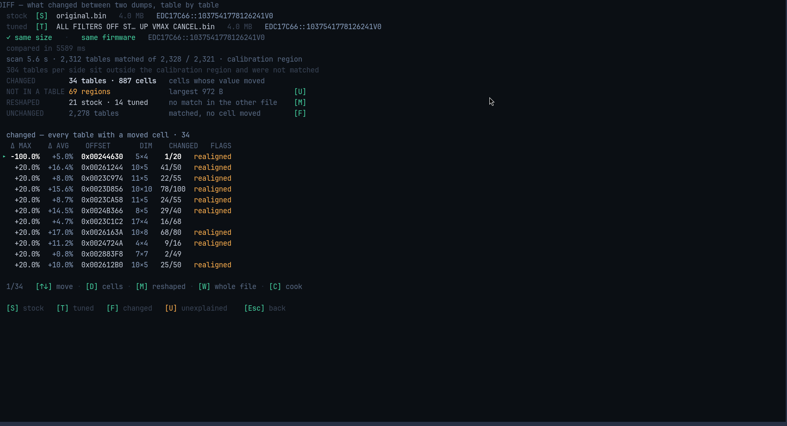

# DIFF

COOK turns a difference into a reusable recipe. DIFF answers the simpler question
first: **what changed?**



## The summary — the important part

```
CHANGED        34 tables · 887 cells    cells whose value moved
NOT IN A TABLE 69 regions               largest 972 B            [U]
RESHAPED       21 stock · 14 tuned       no match in the other file [M]
UNCHANGED      2,278 tables              matched, no cell moved
```

Read the second line carefully: **34 tables changed, and 69 changed areas belong to
no table at all.** Both numbers are shown, because hiding the second one would make
the first look like the whole story.

## The list

Each row is one table that changed:

| Column | Meaning |
|---|---|
| `Δ MAX` / `Δ AVG` | the biggest and average change, in percent |
| `OFFSET` | where the table is (`0x00244630`) |
| `DIM` | rows × columns |
| `CHANGED` | cells changed out of cells in the table (`1/20`) |
| `FLAGS` | `realigned` means the table was found at a different place in the tuned file |

A row like `-100.0% +5.0%` is not an error — it means the table was rebuilt in the
tuned file, so its percentages are measured against a different grid.

## Keys

| Key | What it does |
|---|---|
| `S` | choose the stock file |
| `T` | choose the tuned file |
| `Enter` | compare them |
| `↑` `↓` | move through the changed tables |
| `D` | open one table cell by cell: stock, tuned, and the difference |
| `P` | write both tables as pictures |
| `X` | write the differences as a spreadsheet (CSV) |
| `U` | list the changed areas that no table explains |
| `M` | show only the reshaped tables |
| `C` | send these two files to [COOK](cook.md) |
| `Esc` | back to HOME |

The two files are shared with COOK in both directions, so you never choose them
twice.
