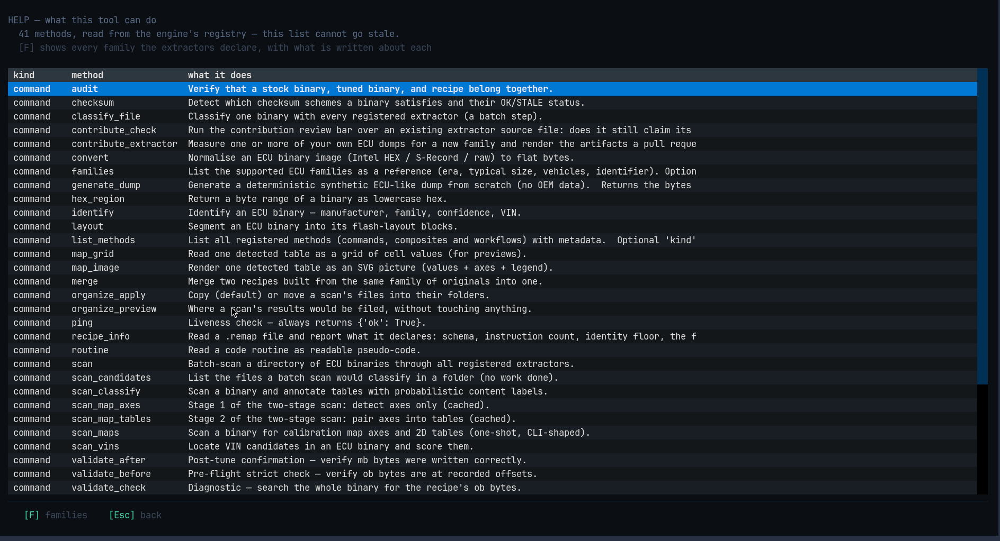

# HELP

Press `H` or `?` on [HOME](home.md). Two plain questions, two plain lists.

## Capabilities — 41 methods

Every operation the program can perform: `kind`, `method`, `what it does`.

| Column | Meaning |
|---|---|
| `kind` | what sort of operation it is — `command` (one step), `composite` (a few steps that give one answer), `workflow` (a saved pipeline) |
| `method` | its name, e.g. `identify`, `cook_strict`, `apply_any` |
| `what it does` | one sentence, written where the code lives |

The important part is the line above the list:

> `41 methods, read from the engine's registry — this list cannot go stale.`

Nothing on this screen is typed into a document. It is read from the running
program, so a feature that is added appears here, and one that is removed
disappears. You are never reading a list for a different version than the one you
have.

Scrolling down reaches the rest of the 41; `[F] families` switches to the other
list.

## Families

The ECUs the tool knows: maker, era, typical file sizes, the cars each one came in,
and the identifier it is recognised by.

This is **reference material, not detection**. A family being in the list does not
mean your file will be recognised as that family — recognition only happens when
your own file matches.

## Keys

| Key | What it does |
|---|---|
| `C` | capabilities (the method list) |
| `F` | families |
| `↑` `↓` | scroll |
| `Esc` | back to HOME |

Nothing on this screen can change anything. It is there for the moment before you
know which of the eight tasks you want.
