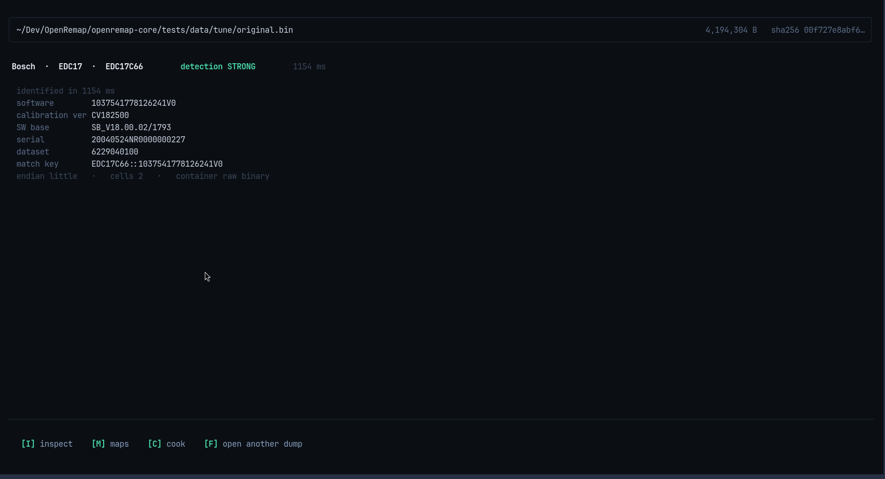

# IDENTIFY

Press `1` on [HOME](home.md). This is the first question you ask about any file:
**what is it?**



## Reading the screen, top to bottom

**Line 1 — which file.** The path you opened, its size (`4,194,304 B`) and a
fingerprint of its contents (`sha256 00f727e8abf6…`). The path is relative to your
home folder, so no long absolute path is printed.

**Line 2 — the answer.** Three green facts and a strength:

```
Bosch  ·  EDC17  ·  EDC17C66        detection STRONG        1154 ms
```

That is: the maker, the ECU family, and the exact variant — then how strong the
match is, and how long it took (about one second for a 4 MB file).

**The block under it — details the family stores:**

| Line | In plain words |
|---|---|
| `software` | the software version inside the file — **the most important line here** |
| `calibration ver` | the calibration data version |
| `SW base` | the base software string |
| `serial` | a serial number written by the manufacturer |
| `dataset` | the data set identifier |
| **`match key`** | the name tag for this exact software |
| `endian` · `cells` · `container` | how the numbers are stored, and what kind of file it is |

Only the lines this family actually stores are shown. Others are left out
completely rather than printed as blanks.

**The bottom bar — what you can do next.** `[I] inspect  [M] maps  [C] cook
[F] open another dump`. The file you just identified is carried into whichever
screen you pick, so you never choose it twice.

## Why the match key matters

`EDC17C66::1037541778126241V0` is the name tag for **one software version** — not
for one car. Two files carrying the same tag are the same software, even if one is
stock and one is tuned.

That line is what [APPLY](apply.md) checks before it writes anything. If the tags
differ, the tool refuses, because a change recorded for one version may not belong
in another.

## Keys

| Key | What it does |
|---|---|
| `F` | open a different file |
| `I` | go to [INSPECT](inspect.md) with this file |
| `M` | go to [MAPS](maps.md) with this file |
| `C` | go to [COOK](cook.md) with this file as the stock file |
| `Esc` | back to HOME |

## If it says UNKNOWN

Some files are not recognised — an unusual ECU, an encrypted calibration, a file
that is not from an engine computer at all. The screen says **UNKNOWN** and does not
guess a family to look confident.

You can still work with such a file: layout, tables and checksums all work. And
[CONTRIBUTE](contribute.md) is the path to adding support for that ECU.

Nothing is written to disk here. This screen only reads.
