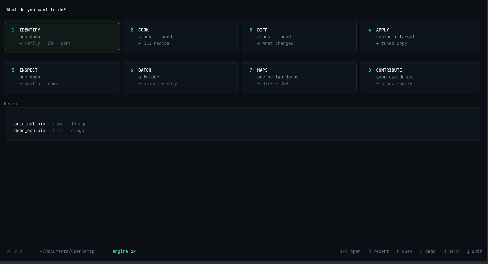

# TUI

Type `openremap` in a terminal and a full-screen app opens. No browser, no
account, no internet — just a terminal.



Think of it as a workshop with eleven rooms. Each room answers **one question**
about a file from a car's engine computer:

| Room | The question |
|---|---|
| [BOOT](boot.md) | is everything installed and working? |
| [HOME](home.md) | what do I want to do? |
| [IDENTIFY](identify.md) | what is this file? |
| [INSPECT](inspect.md) | is this file sane? |
| [MAPS](maps.md) | which tuning tables are inside? |
| [COOK](cook.md) | what is the difference between these two files? |
| [DIFF](diff.md) | what exactly changed? |
| [APPLY](apply.md) | put this change onto that file |
| [BATCH](batch.md) | what is in this folder? |
| [CONTRIBUTE](contribute.md) | can I add my ECU to the tool? |
| [HELP](help.md) | what can this thing do at all? |
| [PICKER](picker.md) | where is the file I want? |

## Starting it

```bash
openremap            # opens the app
openremap --fast     # opens it without the pause on the first screen
openremap-tui        # the same app, another name
```

## How to move around

- **`Esc`** always means *go back one screen*.
- **`Q`** quits from the first screen (**`Ctrl+C`** quits from anywhere).
- Every screen shows its keys in a **bar at the bottom**. Those are the keys that
  work *right now* — if a key is not printed, it does nothing on that screen.
- One letter, one action. There are no hidden menus.

## Where your files go

The app saves results in one folder, so nothing lands somewhere random:

| Folder | What ends up there |
|---|---|
| `recipes/` | recipe files you saved |
| `tunes/` | patched files you wrote |
| `exports/` | pictures and CSV files |
| `ecus/` | the demo file, if you asked for one |

That folder is `~/Documents/OpenRemap` on Linux and macOS (or `~/OpenRemap` if you
have no Documents folder) and `Documents\OpenRemap` on Windows. Your own files are
never moved or changed.

## Two things the app always does

**It warns before it saves.** When a result exists only in memory, a line above the
keys says `⚠ NOT SAVED` or `⚠ NOT WRITTEN` **and tells you the full path** it would
use. Nothing is written until you press the key.

**It says what it does not know.** A checksum reads `ok`, `fail` or `skip` —
`skip` means "I have no way to check this family", which is not the same as "fine".
A table is an offset and a size, never an invented name.
