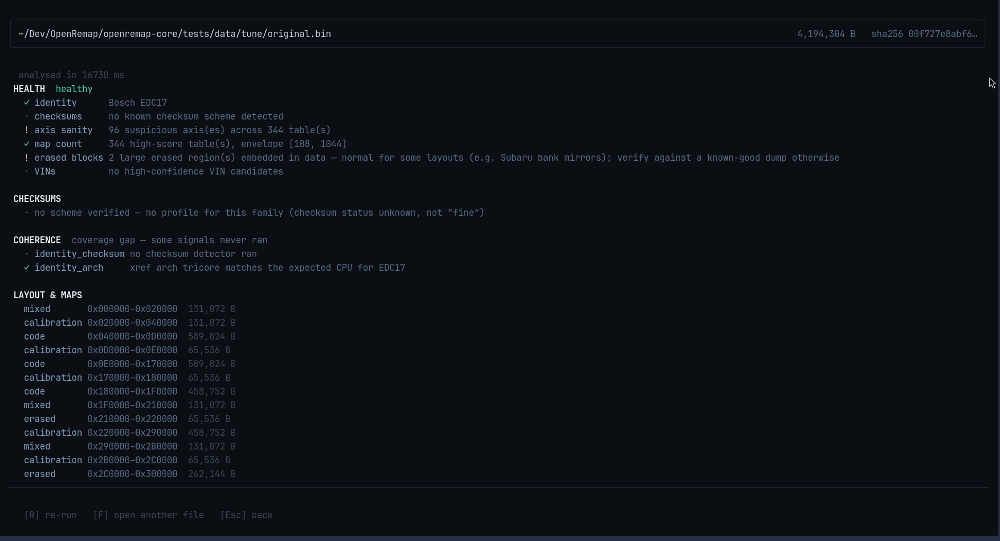

# INSPECT

[IDENTIFY](identify.md) tells you *what* a file is. INSPECT tells you *whether it
is in good shape*.

## What you see

The screen is four blocks, top to bottom.

**HEALTH** — six checks, each with one word and one sentence:

| Check | What it looks at |
|---|---|
| identity | was the ECU recognised? |
| checksums | do the stored check numbers still match the data? |
| axis sanity | do the table axes look like real values? |
| map count | is the number of tables normal for this family? |
| erased blocks | are there large empty areas inside the data? |
| VINs | is there a believable vehicle ID number in the file? |

**CHECKSUMS** — the honest version of the same answer. If no checksum scheme is
known for that family it says so:

> `no scheme verified — no profile for this family (checksum status unknown, not "fine")`

That sentence is the whole point: "I cannot check this" must never look like
"this is fine".

**COHERENCE** — do the independent answers agree? `coverage gap` means one of them
never ran, so nobody can say. `identity_arch` confirms the code inside matches the
CPU the family is supposed to use.

**LAYOUT & MAPS** — the map of the file: which areas are program (`code`), tables
(`calibration`), empty (`erased`) or mixed, with sizes and addresses.

## Keys

| Key | What it does |
|---|---|
| `F` | open another file |
| `R` | run the checks again |
| `Esc` | back to HOME |

## Why it takes a few seconds

This is the deep check — the one that reads the whole file. The spinner shows the
seconds counting up while it works; there is no fake progress bar, because the
program does not know how far along it is.

Reads only. Nothing is written.
