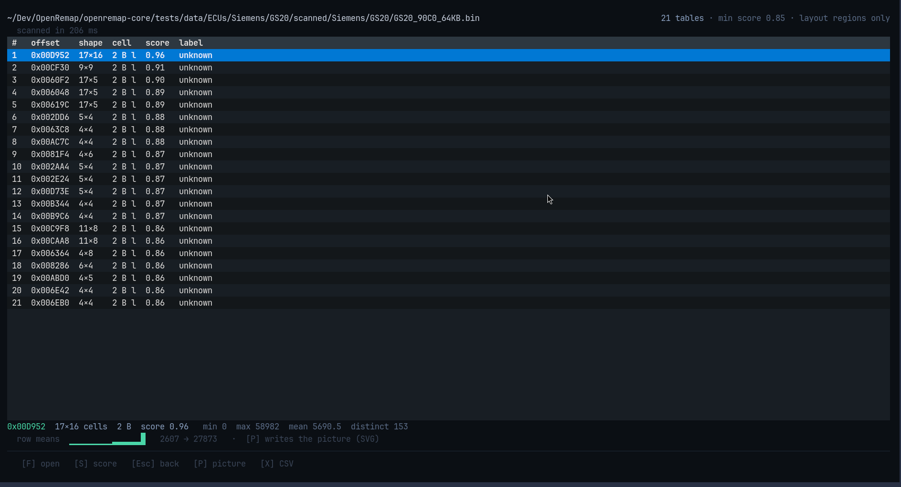
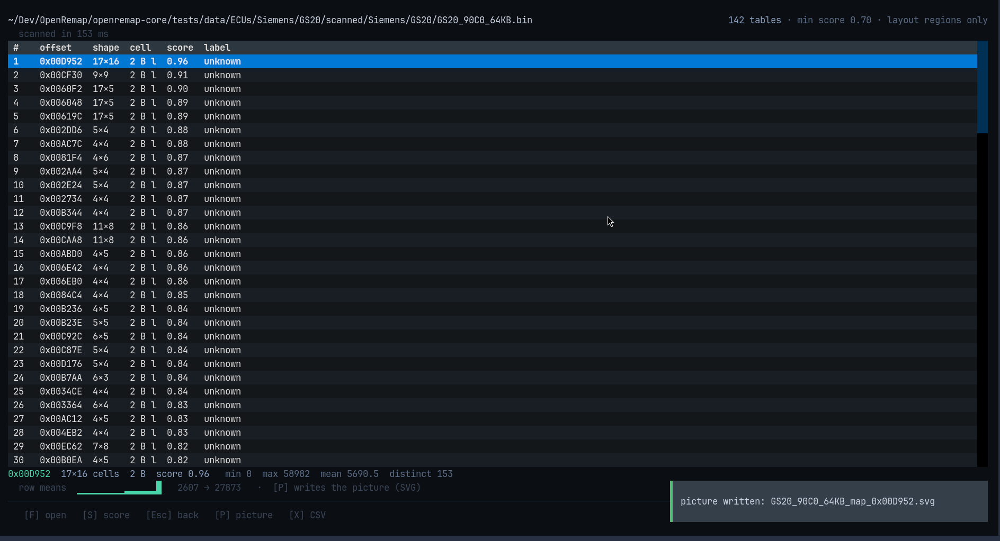

# MAPS

A **map** (or table) is a grid of numbers in the file: fuel, boost, ignition timing
and so on. This screen finds them and lets you look at one.

## Reading the list

Each row is one table:

| Column | Meaning |
|---|---|
| `#` | row number, for your own reference |
| `offset` | where the table starts in the file, e.g. `0x00D952` |
| `shape` | rows × columns, e.g. `17×16` |
| `cell` | how many bytes each number takes (usually 2) |
| `score` | how table-like it looks (0 to 1) |
| `label` | a guess about what it is — or `unknown`, which is a normal answer |

The line under the list describes the table you have selected, measured from the
file itself: smallest and largest value, average, how many different values, and a
green `row means` bar that shows the shape at a glance.

## The picture

Press `P` and the selected table is written to disk as an **SVG picture** — colours
for the values, the real axis numbers read from the file, and a scale. It opens in
any browser or image viewer.

The green line at the bottom right confirms it: `picture written:
GS20_90C0_64KB_map_0x00D952.svg`.

## Why a picture file instead of drawing it here

A terminal has no pixels. A map painted in characters depends on your font, your
colours and your window shape — it can look wrong while claiming to be data. A
file cannot: everyone sees the same picture.

## Keys

| Key | What it does |
|---|---|
| `F` | open a file |
| `S` | show fewer tables per press: `0.85 → 0.70 → 0.55 → 0.00` |
| `P` | write the selected table as an SVG picture |
| `X` | write the list of tables as a CSV file |
| `↑` `↓` | move up and down the list |
| `Esc` | back to HOME |

In the second screenshot `S` had been pressed once — `min score 0.70` — so 142
tables are shown instead of 21.

## What it does not claim

- A **label** is a guess, and `unknown` is honest.
- A **score** is not a probability; it only means the shape looks like a table.
- No row claims to be "the torque limiter" — the tool does not know that.
