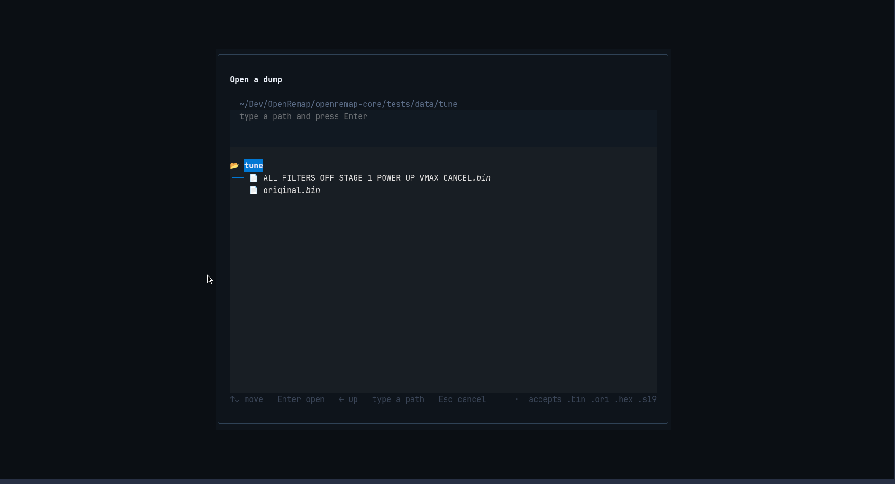

# PICKER

Every `F` key in the app opens this window. It is part of the app, not a system
dialog: nothing else pops up, and it works over SSH where there is no desktop at
all.

## What you see

| Part | Meaning |
|---|---|
| **title** | what this picker is for — here `Open a dump` (a folder picker says something else) |
| **path line** | the folder you are in, e.g. `~/Dev/OpenRemap/…/tests/data/tune` |
| **hint** | `type a path and press Enter` — you can paste a full path instead of clicking |
| **the list** | folders (with a folder icon) and files; the highlighted row is where `Enter` acts |
| **bottom bar** | the keys, and on the right the types this picker accepts: `accepts .bin .ori .hex .s17` |

Only file types the screen can actually use are listed, so you cannot pick something
it will reject later.

## Keys

| Key | What it does |
|---|---|
| `↑` `↓` | move through the list |
| `Enter` | open a folder, or choose the highlighted file |
| `←` | up one level |
| typing | goes into the path field, so you can paste a path |
| `Space` | choose the highlighted folder — only when the screen asked for a folder |
| `Esc` | cancel and go back |

## Where it opens

Where you last chose a file; failing that the app's own `ecus/` folder, then
`Downloads`, then your home folder. A picker that only shows the app's own folder
would be useless on a fresh install, where that folder is empty.

## It never fails silently

| What you did | What it says |
|---|---|
| typed a folder that does not exist | `no such folder: …`, and the picker stays open |
| chose a file the screen cannot use | names the file and the types it wanted |

On Windows the drives are listed at the top and can be typed into the path field
(`D:` becomes `D:\`), because a folder tree cannot climb out of a drive on its own.
On Linux and macOS that row does not exist, since drives are not a concept there.
